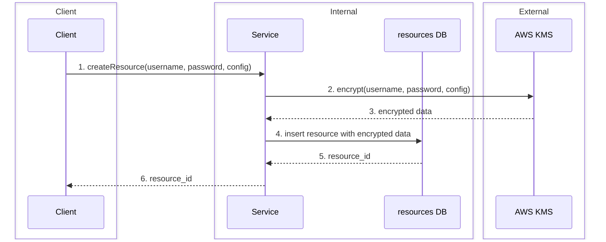
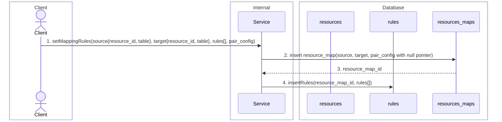
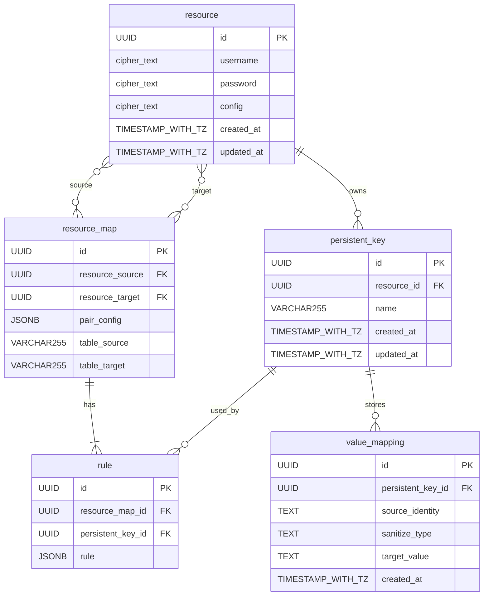

# Overall Workflows

This document provides the comprehensive workflows in `rep-pro` and acts as the single source of truth.

## Table of contents

- [Project scope](#project-scope)
- [Create resource](#create-resource)
- [Set mapping rules](#set-mapping-rules)
- [ER diagram](#er-diagram)

## Project scope

`rep-pro` is a **client-driven data sanitization** service. It lets a client move data from a source to a target while applying sanitization logic that the client configures itself, rather than logic hard-coded into the service.

The client configures three things:

- **Source** — a registered resource and the table to read from.
- **Target** — a registered resource and the table to write the sanitized data into.
- **Rules** — a list of mapping rules that describe, per column, how a source column maps to a target column and the sanitization logic to apply during the copy (e.g. masking, hashing, redaction, format transforms).

Given that configuration, the service is responsible for:

1. Securely storing the source/target connection details (encrypted via AWS KMS).
2. Persisting the source ↔ target mapping and its rules.
3. Executing the configured rules to produce sanitized data in the target.
4. Guaranteeing **consistent mapping** of sanitized values across runs (see below).

### Consistent mapping

For any given source row, the sanitized target values must be **stable across every sanitization run and across links that share a persistent key**. Each source resource owns named persistent keys. A rule names one of those keys. The lookup is the row's source identifier (for example user id `42`) plus the sanitize type. If that identity is first sanitized to the name `Foo`, every later run — and every other link from the same source that reuses the key — must also produce `Foo` for that id. Two columns of the same sanitize type on one row share one stored value. Two different row identities never share a target value for the same sanitize type under one key.

This guarantee is what keeps the sanitized target usable: joins, foreign keys, deduplication, and longitudinal analytics on the target only stay valid if the source-to-target value mapping is deterministic over time.

Because the sanitization logic itself (e.g. random pseudonymization) is not generally reproducible from the source row alone, the service must **persist the value mappings it has already produced** and look them up before generating a new one. Conceptually:

- On first encounter of a row identity for a sanitize type under a persistent key, the service generates a target value and stores `(persistent_key, source_identity, sanitize_type) → target_value`.
- On every subsequent encounter, the service returns the previously stored target value instead of generating a new one.

This is reflected in the [ER diagram](#er-diagram) by the `value_mapping` entity.

Out of scope: orchestration/scheduling, business-level data quality checks, and any sanitization logic that is not expressible as a column-level rule.

## Create resource

The client submits credentials and configuration. The service encrypts the sensitive fields via AWS KMS before persisting the resource and returns the generated `resource_id`.



> **Note (step 1):** an additional authorization check can be added before encryption to validate that the caller has the required permissions (or admin role) to register a resource with the supplied credentials.

## Set mapping rules

The client defines how a source table maps to a target table and the rules that govern the mapping. The service first creates the `resource_map` (including an initial `pair_config`) and then attaches the rules to it.

`pair_config` is per source→target pair. It stores the pull batch strategy and the checkpoint pointer (or offset). The pointer starts as `null` when the map is created. After a successful run, `sync_up_config` writes the updated strategy and pointer back to `resource_maps.pair_config` so the next run resumes from that checkpoint.

```json
{
  "pull_batch_strategy": "cursor",
  "pull_batch_field": "id",
  "pull_batch_checkpoint": null
}
```



## ER diagram



> **Notes:**
>
> - `persistent_key.name` is unique per source resource, so two sources can both have a key named `customer`.
> - `value_mapping` enforces a uniqueness constraint on `(persistent_key_id, source_identity, sanitize_type)` so that the consistent mapping guarantee holds at the storage layer.
> - `resource_map.pair_config` is the pull strategy plus pointer for that pair. A successful sanitization run updates it via `sync_up_config`; it is not stored on the resource itself.
